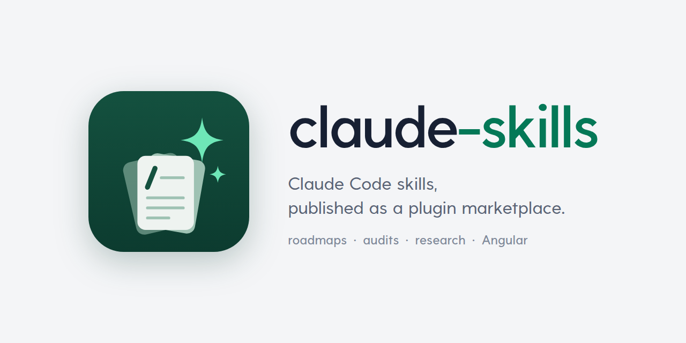

<p align="center">
  <picture>
    <source media="(prefers-color-scheme: dark)" srcset="assets/banner-dark.png">
    
  </picture>
</p>

<p align="center">
  <a href="https://github.com/FreekMencke/claude-skills/actions/workflows/validate.yml"></a>
</p>

## Install

```bash
claude plugin marketplace add FreekMencke/claude-skills
claude plugin install freek-skills@freek-skills
claude plugin install freek-local-skills@freek-skills   # Claude Code only
```

On claude.ai: Customize › Plugins › Add marketplace `FreekMencke/claude-skills`, then install `freek-skills`.

## Skills

| Skill | What it does | Runs on |
|---|---|---|
| `roadmap-issues` | Plan work as a GitHub roadmap issue with ordered sub-issues | Any agent |
| `parallel-code-orchestrator` | Split a large coding task over parallel subagents | Claude Code |
| `refresh-md-files` | Find stale, ambiguous or missing docs | Any agent |
| `skill-workshop` | Write or audit a skill | Best in Claude Code |
| `design-workshop` | Choose a page's look one small visual choice at a time, ending in a design brief | Any agent |
| `research` | Answer a question with exact quotes, re-checked sources and tested claims | Best in Claude Code |
| `tech-debt-audit` | Ranked technical-debt audit of a codebase | Best in Claude Code |
| `angular-conventions` | Opinionated Angular rules on top of `angular-developer` | Any agent |
| `angular-developer` | Angular's official skill, mirrored weekly | Any agent |
| `handoff` * | Save the session's state, `/clear`, and continue from it | Claude Code |
| `token-audit` * | Measure token spend from your local transcripts | Claude Code |
| `seo-audit` * | Read-only technical SEO audit of a site ([data setup](plugins/freek-local-skills/skills/seo-audit/references/data-sources.md#giving-a-session-the-data-for-the-user)) | Best in Claude Code |
| `ui-review` * | Read-only UI, design and states review of a running page (Playwright check script, `ui-reviewer` subagent) | Claude Code |
| `font-outline-repair` * | Audit and repair a weight family's UFO masters, and re-derive Thin and Black from them (Python venv, `font-outline-reviewer` subagent) | Claude Code |

Runs on:

- **Any agent**: needs no Claude Code feature, so it works in any agent that reads [Agent Skills](https://agentskills.io),
  such as Codex or GitHub Copilot.
- **Best in Claude Code**: runs elsewhere, but is tuned to Claude Code's subagents, models and tools, and falls back
  to a weaker path without subagents: a self-check instead of an independent reviewer, a single reader instead of several.
  `skill-workshop` checks a skill against Claude Code's rules.
- **Claude Code**: needs its subagents with worktrees, its slash commands or its transcripts.

\* In `freek-local-skills`, which installs in Claude Code only. `handoff` and `token-audit` run as slash commands, such as
`/freek-local-skills:handoff`. Claude Code enforces `seo-audit`'s read-only rule (`disallowed-tools`); another agent
may only read it as an instruction. `font-outline-repair` runs its Python scripts in a venv it sets up
(`~/.venvs/fontrepair`) and hands its renders to the plugin's `font-outline-reviewer` subagent. `ui-review` runs its
check script with Node and Playwright (from the app's repo, or installed in the scratchpad) and needs the Playwright
plugin for its `ui-reviewer` subagent.

## License

[MIT](LICENSE). `plugins/freek-skills/skills/angular-developer/` is Angular's, under its own MIT license (see its `NOTICE`).
`plugins/freek-local-skills/skills/ui-review/references/guidelines.md` is an edited copy of Vercel's Web Interface
Guidelines, MIT, with its notice in the file.
